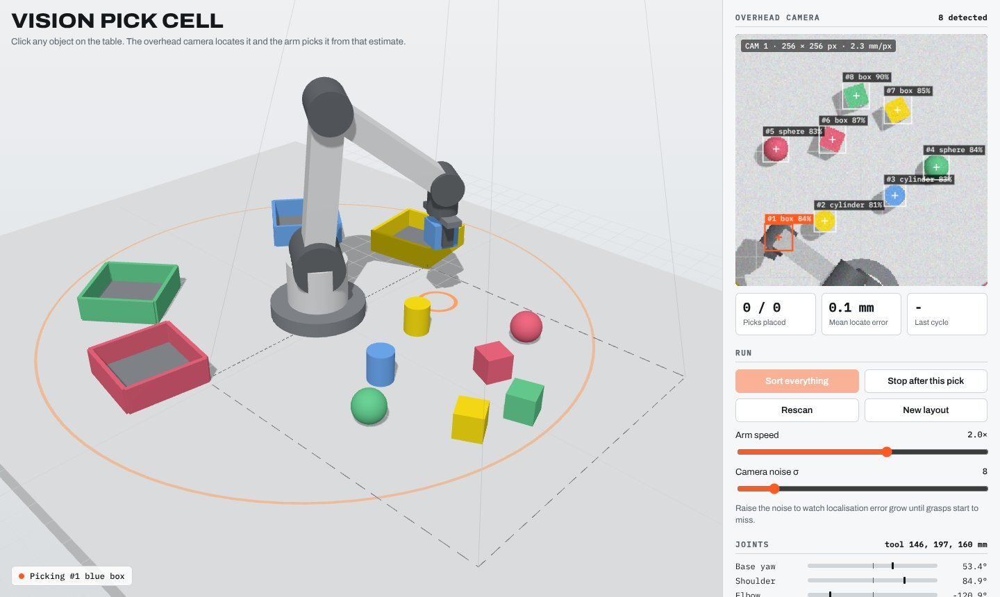
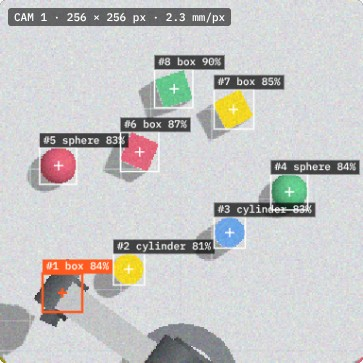

# Vision Pick Cell

A browser-based robot work cell. An overhead camera locates parts on a table, and a 5-axis arm picks each part from the camera's estimate and sorts it into the bin that matches its colour.

**Live demo:** https://tomiwa-ttt.github.io/vision-pick-cell/



## What it does

- Click any part in the 3D view, or click a detection in the camera feed, and the arm picks it.
- **Sort everything** runs the full loop: scan, pick, place, rescan, until the table is clear.
- **Camera noise** adds Gaussian sensor noise to the image so you can watch localisation error grow until grasps start to miss.
- The panel shows live joint angles, tool position, every detection in the robot frame, and pick statistics.



## Vision pipeline

The arm never reads part positions from the simulator. It only acts on what the camera reports.

1. An orthographic camera 1.5 m above the table renders a 256 x 256 image (about 2.3 mm per pixel).
2. Each pixel is converted to HSV. Saturated pixels are classed as red, yellow, green or blue.
3. Connected-component labelling groups pixels into blobs and drops anything under 60 px.
4. Each blob gives:
   - **Position** from its centroid, mapped back to table coordinates through the camera model
   - **Shape** from its fill ratio against the enclosing circle (box vs round), then brightness spread (sphere vs cylinder)
   - **Box yaw** from the direction of its farthest corner
5. Each estimate is compared with ground truth only for the error column in the UI.

Across 6 random layouts (48 parts) at the default noise level, every part was detected and classified correctly, with a maximum position error of 0.4 mm and a maximum box yaw error of 3.3°.

## Kinematics and motion

- 5-axis arm: base yaw, shoulder, elbow, wrist pitch, wrist roll, plus a parallel gripper.
- Closed-form inverse kinematics (two-link planar solution, elbow up) keeps the gripper vertical.
- Wrist roll is solved so the fingers close on opposite faces of each box.
- Vertical approach and lift moves are straight Cartesian lines solved with IK every frame. Transfers between table and bins are smooth joint-space moves.
- A grasp only holds if the estimate is within 16 mm of the real part (and within 15° for boxes), so bad vision produces real misses.

## Tech

- Three.js (r128) for rendering, with a separate render target for the vision camera
- Plain JavaScript image processing on `readRenderTargetPixels` output (HSV thresholding, flood-fill labelling, image moments)
- Single HTML file, no build step

## Run locally

Open `index.html` in a browser, or serve the folder:

```bash
python3 -m http.server 8000
```

## License

MIT
